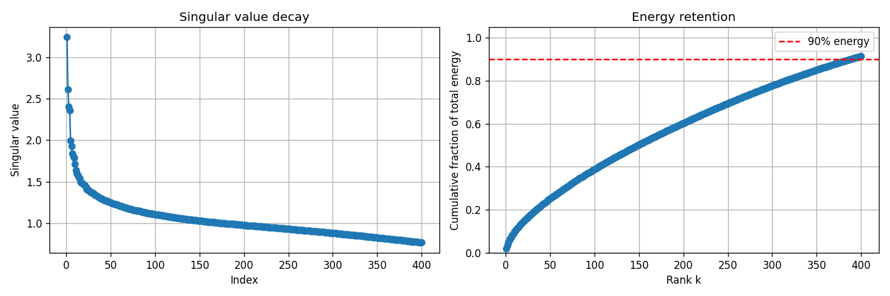
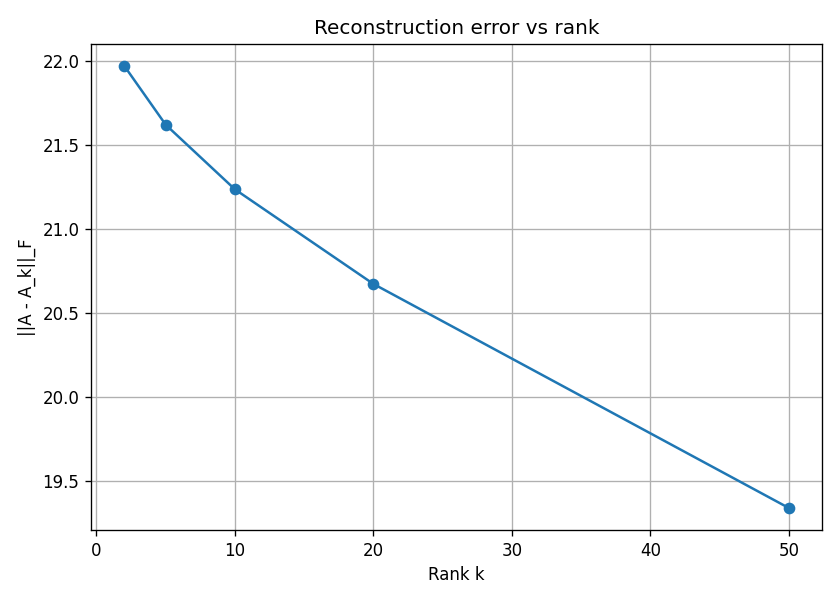
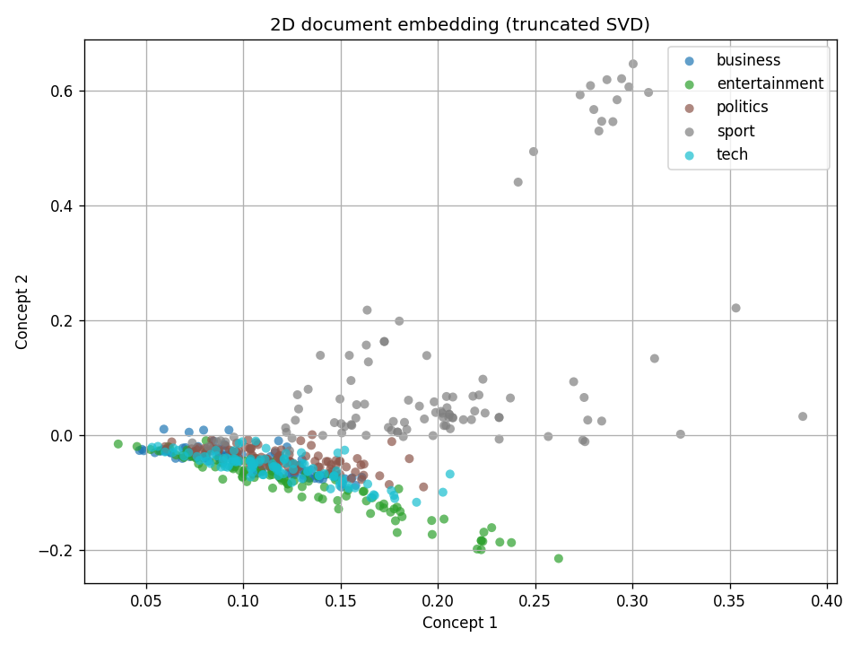

# SVD-Based Topic Modeling from Scratch

A Python implementation of Singular Value Decomposition (SVD) for topic modeling on BBC News articles, using **power iteration and deflation** instead of built-in SVD or eigendecomposition functions.

Developed as a term project for the **Numerical Methods** course at Istanbul Technical University.

## Project Overview

This project explores how truncated Singular Value Decomposition can be used to discover latent patterns in a collection of news articles.

The implementation processes BBC News articles, constructs a TF-IDF document-term representation, computes leading singular values and vectors, and analyzes the resulting low-rank approximations.

The default configuration processes up to 100 articles from each of five categories: business, entertainment, politics, sport, and tech.

## Methodology

The project consists of five main stages:

1. **Text preprocessing:** Tokenization, lowercasing, stop-word removal, and vocabulary construction.
2. **TF-IDF computation:** Manual construction of a normalized term-document matrix using NumPy.
3. **SVD implementation:** Computation of leading eigenpairs of \(A^T A\) using power iteration and deflation, followed by reconstruction of the singular vectors.
4. **Low-rank analysis:** Evaluation of Frobenius reconstruction error and retained energy for different approximation ranks.
5. **Topic exploration:** Extraction of high-weight terms from singular vectors and visualization of documents in a two-dimensional latent space.

The core SVD computation does not use `numpy.linalg.svd` or built-in eigendecomposition functions. An optional validation mode compares the computed singular values with NumPy's SVD implementation.

## Results

### Singular Value Decay and Energy Retention



This visualization shows the decay of singular values and the cumulative fraction of the original matrix's energy retained by successive components.
The singular value decay and energy retention plots were generated using 400 components, while the reconstruction error analysis reports ranks up to 50.

### Reconstruction Error



The Frobenius reconstruction error decreases as the approximation rank increases.

| Rank (k) | Frobenius Error | Retained Energy |
|---|---|---|
| 2 | 21.9698 | 3.47% |
| 5 | 21.6186 | 6.53% |
| 10 | 21.2343 | 9.82% |
| 20 | 20.6715 | 14.54% |
| 50 | 19.3386 | 25.20% |

### Two-Dimensional Document Embeddings



Documents are projected onto the first two singular-vector components and colored according to their original BBC News categories.

The visualization provides a qualitative view of category-related patterns in the reduced representation. It is not a classification accuracy measurement.

### Topic Terms

The project extracts the ten highest-magnitude terms for each of the first five singular-vector components.

The corresponding term weights are available in [`results/topic_terms/`](results/topic_terms/).

## Installation

Clone the repository and install the required dependencies:

```bash
git clone https://github.com/zerenkarabulut/svd-topic-modeling-from-scratch.git
cd svd-topic-modeling-from-scratch
pip install -r requirements.txt
```

## Dataset

The project uses the **BBC News dataset**, organized into five category folders.

Download the dataset separately and organize the files as follows:

```text
bbc/
├── business/
├── entertainment/
├── politics/
├── sport/
└── tech/
```

Each category folder should contain the corresponding news articles as `.txt` files.

The dataset is not included in this repository.

## Usage

Run the implementation with:

```bash
python svd_topic_modeling.py --data_path bbc --output_path results --max_docs 100 --k_svd 50
```

To compare the computed singular values against NumPy's SVD implementation, add the optional `--validate` flag:

```bash
python svd_topic_modeling.py --data_path bbc --output_path results --max_docs 100 --k_svd 50 --validate
```

The program generates reconstruction statistics, singular-value plots, document embeddings, and topic-term files. It also saves the computed TF-IDF matrix locally.

## Technologies

- Python
- NumPy
- Matplotlib

## Notes

This project focuses on implementing and analyzing the numerical methods underlying SVD rather than optimizing computational performance.

The implementation uses a dense TF-IDF matrix and sequential eigenpair extraction. These choices make the underlying numerical procedure easier to examine but are less efficient than specialized sparse-matrix and truncated-SVD algorithms for large datasets.
